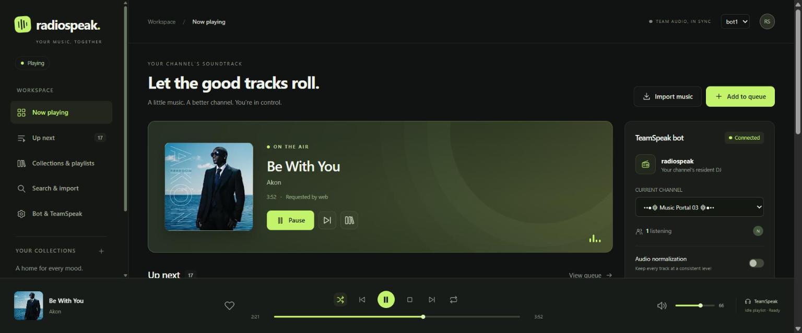
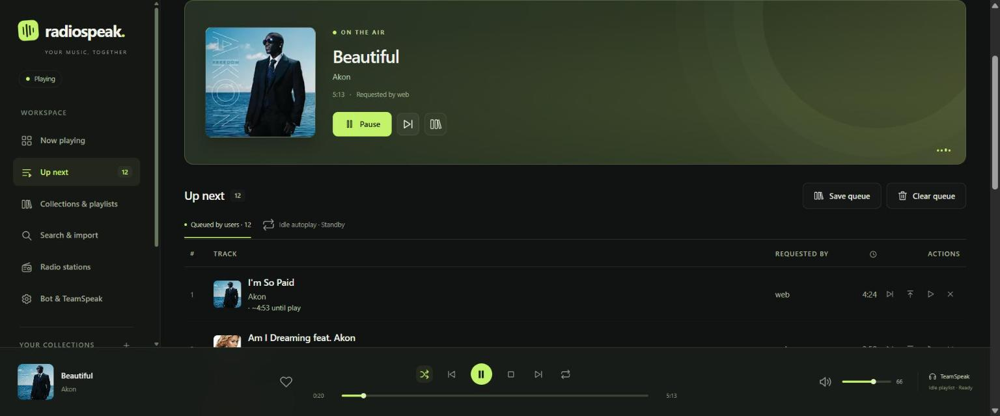
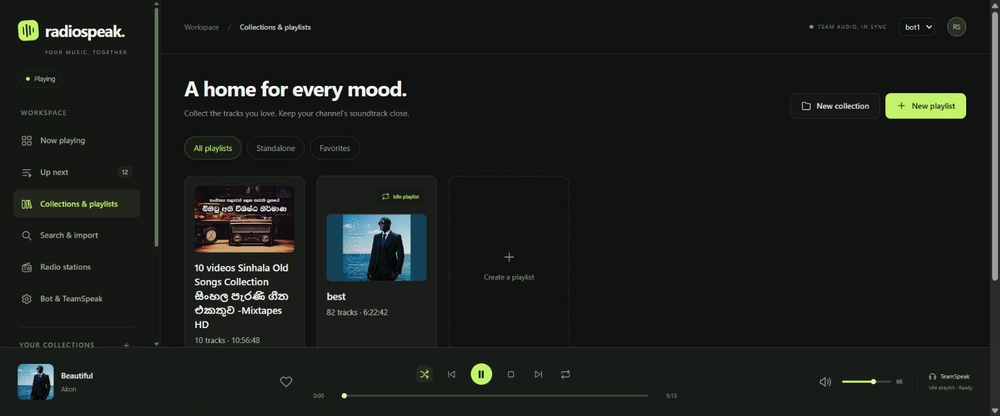
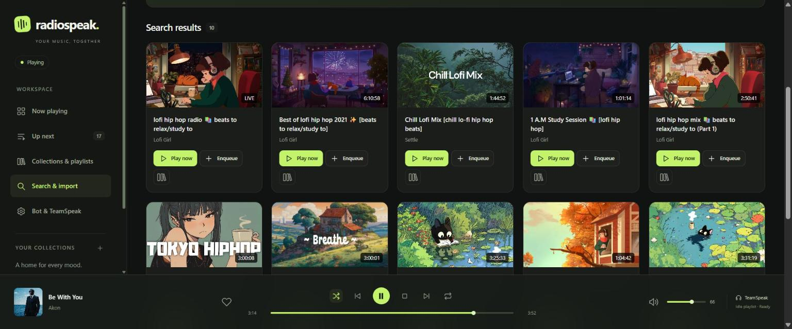
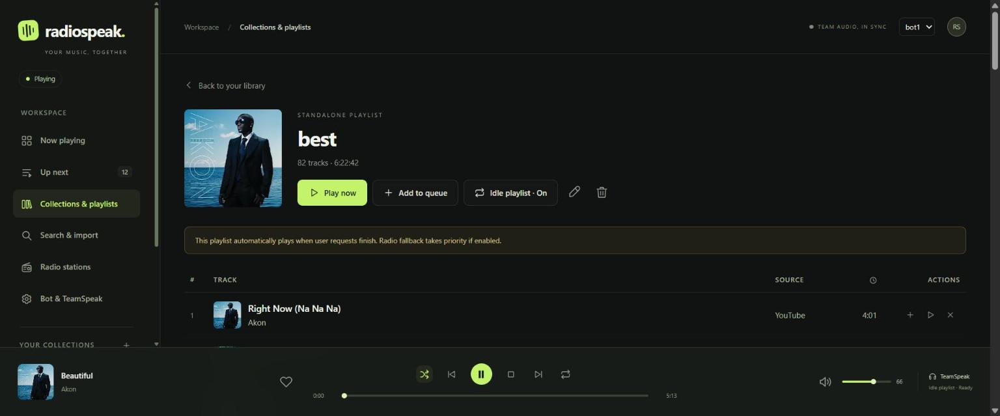
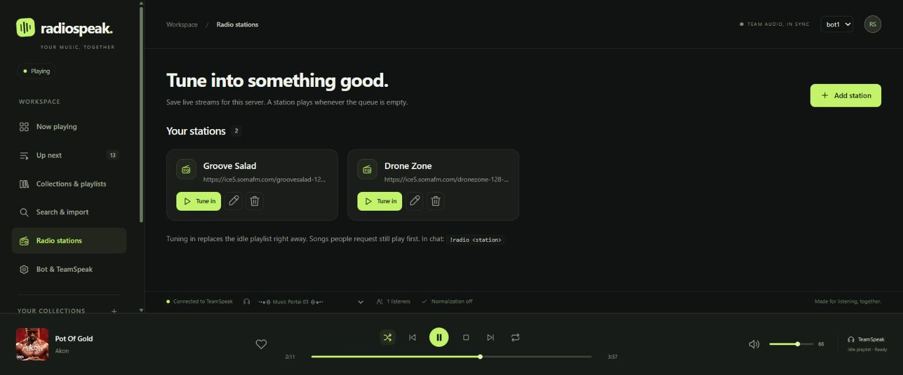
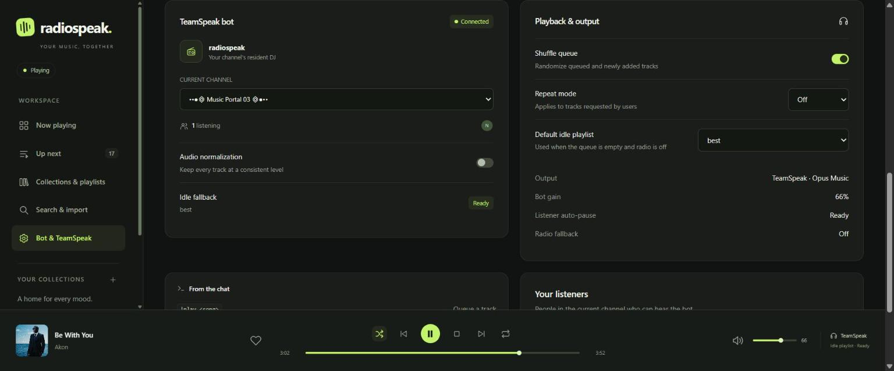

<div align="center">


# radiospeak

**Your channel. Your soundtrack.**<br>
A self-hosted music bot for TeamSpeak 3/6 and Discord, with a shared web control panel.

[](docker-compose.yml)
[](https://teamspeak.com)
[](https://discord.com)

[Features](#features) • [Install](#install-with-docker) • [Update](#update) • [Web panel](#using-the-web-panel) • [Discord](#adding-a-discord-bot) • [Chat commands](#chat-commands) • [Contributing](#contributing)



</div>

> [!TIP]
> **Help make radiospeak better!** Found a bug or have an idea? Please [report a bug](https://github.com/nooblk-98/radiospeak/issues/new?template=bug_report.yml) or [request a feature](https://github.com/nooblk-98/radiospeak/issues/new?template=feature_request.yml) on the [Issues](https://github.com/nooblk-98/radiospeak/issues) page. Every report helps make the project better.

radiospeak joins your TeamSpeak or Discord server as a voice client. It plays music from YouTube, SoundCloud, live radio and any other site [yt-dlp](https://github.com/yt-dlp/yt-dlp) supports. Listeners control it from chat, and admins use a web panel to manage the queue, playlists, radio stations and several bots.

## Features

- **Play almost anything**: paste a link or type search words to play songs and playlists from YouTube, SoundCloud and more.
- **Real queue**: play next, drag to reorder, remove with Undo, shuffle, repeat one or all, and pause and resume where you left off.
- **Saved library**: keep playlists, collections and favorites, and import public YouTube playlists without duplicates.
- **Never silent**: when the queue is empty, an idle playlist or a live radio station takes over. Requests always play first.
- **Radio stations**: save Icecast, SHOUTcast or HTTP streams and tune in with one click.
- **Several bots**: run TeamSpeak and Discord bots side by side. Each has its own channel, queue, volume and playlists.
- **Listener-aware**: pauses when the channel empties and resumes when someone joins.
- **Survives restarts**: the queue and position are restored after a reboot or reconnect.

<table>
  <tr>
    <td></td>
    <td></td>
  </tr>
  <tr>
    <td align="center"><sub>Up next: reorder, play next, undo removals</sub></td>
    <td align="center"><sub>Collections, playlists and favorites</sub></td>
  </tr>
  <tr>
    <td></td>
    <td></td>
  </tr>
  <tr>
    <td align="center"><sub>Search YouTube and SoundCloud</sub></td>
    <td align="center"><sub>Play now, add to queue or set as idle playlist</sub></td>
  </tr>
  <tr>
    <td></td>
    <td></td>
  </tr>
  <tr>
    <td align="center"><sub>Saved radio stations</sub></td>
    <td align="center"><sub>Channel, playback and idle playlist per bot</sub></td>
  </tr>
</table>

## Install with Docker

You need a machine with [Docker](https://docs.docker.com/get-docker/) and Docker Compose. The image already includes everything else (FFmpeg, yt-dlp).

1. Download radiospeak:

   ```bash
   git clone https://github.com/nooblk-98/radiospeak.git
   cd radiospeak
   ```

2. Open [docker-compose.yml](docker-compose.yml) and set at least:
   - `FMBOT_SERVER`: your TeamSpeak server address, for example `ts.example.com:9987`. Skip this if you only use Discord.
   - `FMBOT_WEB_PASSWORD`: the password for the web panel. Choose a strong one.

3. Start the bot:

   ```bash
   docker compose up -d --build
   ```

4. Open the panel at `http://<your-server>:48080` and sign in with your password.
5. Go to **Bots & platforms** and pick the channel the bot should sit in. It returns there after every restart.
6. Search for a song, or create a playlist and click **Set as idle playlist** so music plays whenever the queue is empty.

To see what the bot is doing, run `docker compose logs -f`.

> [!WARNING]
> The panel uses plain HTTP. To reach it from the internet, put it behind a reverse proxy with HTTPS (for example Caddy, Nginx Proxy Manager or Traefik).

### Common settings

All settings are environment variables in [docker-compose.yml](docker-compose.yml). Most per-bot settings (channel, name, idle playlist, radio) are easier to change in the panel.

| Variable                                | What it does                                                               |
| --------------------------------------- | -------------------------------------------------------------------------- |
| `FMBOT_SERVER`                          | TeamSpeak server `host:port` (usually port 9987)                           |
| `FMBOT_SERVER_PASSWORD`                 | TeamSpeak server password, empty if none                                   |
| `FMBOT_NICKNAME`                        | The bot's starting name (default `radiospeak`)                             |
| `FMBOT_VOLUME`                          | Starting volume, 0–100                                                     |
| `FMBOT_WEB_PASSWORD`                    | Web panel password                                                         |
| `FMBOT_ADMINS`, `FMBOT_ADMIN_GROUPS`    | TeamSpeak unique IDs or server group IDs allowed to delete saved playlists |
| `FMBOT_PAUSE_WHEN_EMPTY`                | Pause when nobody is in the channel (`true` or `false`)                    |
| `FMBOT_SONG_IN_DESCRIPTION`             | Show the current song in the bot's TeamSpeak description                   |
| `FMBOT_BITRATE`                         | Audio quality in kbps (default 96)                                         |
| `FMBOT_CPU_LIMIT`, `FMBOT_MEMORY_LIMIT` | Upper limits for the container (default 4 CPUs, 4 GB)                      |

To change the panel port, edit the left number in `ports` (`"48080:8080"`). After you change any setting, run `docker compose up -d` again.

## Update

Your playlists, settings and bot identities are kept in the `radiospeak-data` Docker volume, so updating doesn't lose anything.

```bash
cd radiospeak
git pull
docker compose build --pull
docker compose up -d
```

> [!TIP]
> YouTube changes often. If songs suddenly stop playing, run `docker compose build --pull --no-cache && docker compose up -d` to get the newest yt-dlp, even if there is no new radiospeak version.

> [!IMPORTANT]
> Never delete the `radiospeak-data` volume (for example with `docker compose down -v`). It holds each bot's TeamSpeak identity. Without it, the bot reconnects as a new client and loses its server groups. Before big changes, make a backup under **Bots & platforms → Export & import**.

<details>
<summary><strong>Updating from an old version that used a <code>./data</code> folder</strong></summary>

Older versions stored data in a `./data` folder next to the compose file. Move it into the volume once before you start the new version:

```bash
sh scripts/migrate-data.sh radiospeak
docker compose up -d --build
```

The script backs up your old data, copies it into the volume and checks every file. It won't overwrite a volume that already has data.

> [!CAUTION]
> Don't start the new version before migrating. Otherwise the bot starts with a new identity and an empty library.

</details>

## Using the web panel

The panel works on desktop, tablet and phone and updates live. If you run several bots, switch between them from the top bar.

| Section                     | What you can do                                                                                                               |
| --------------------------- | ----------------------------------------------------------------------------------------------------------------------------- |
| **Now playing**             | Play, pause, skip, seek, change volume, shuffle and repeat. See who is listening and the bot's health.                        |
| **Up next**                 | See the queue, drag to reorder, play a song next, or remove songs (with Undo).                                                |
| **Collections & playlists** | Create playlists and collections, mark favorites, filter tracks, select many tracks to copy, move, sort or remove duplicates. |
| **Search & import**         | Search YouTube and SoundCloud, add a link, or import a whole public YouTube playlist in batches.                              |
| **Radio stations**          | Save live streams and tune in with one click. The current song title is shown when the station provides it.                   |
| **Playback history**        | The last 200 songs per bot, who requested them, and a button to request a song again.                                         |
| **Bots & platforms**        | Add, edit or remove TeamSpeak and Discord bots, set each bot's channel, name and idle playlist, and manage the options below. |

In **Bots & platforms** you'll also find:

- **Playback & output**: volume, loudness normalization and **Prepare the next track** for smoother transitions.
- **Performance & requests**: audio quality profile, queue limits per listener, radio fallback order, silence alerts and avoiding recently played idle songs.
- **Playlist schedules**: play a different idle playlist by weekday and time, for example chill music in the morning and upbeat music at night.
- **Access & roles**: sign in as `owner` with the panel password to add named accounts. **Listeners** can search and request songs, **DJs** control playback and playlists, and **Administrators** also manage accounts and bots. You can also give TeamSpeak or Discord users chat roles.
- **Export & import**: save all playlists and settings to a file, or load them into another installation. Tokens, passwords and identities aren't included.
- **Administrative audit log**: see who changed what, and when.

Messages, import progress and Undo actions appear under the bell icon at the top right.

### How the bot picks what to play

1. Songs people request (the queue) always play first.
2. When the queue is empty, the bot's **radio station** plays, if one is set.
3. Otherwise the **idle playlist** plays on repeat and remembers its place.

**Play now** on a playlist replaces the queue with that playlist. **Add to queue** adds it to the end. **Stop** clears the queue and stays silent until you play something.

## Adding a Discord bot

1. In the [Discord Developer Portal](https://discord.com/developers/applications), create an application and add a bot. Copy its **token**.
2. Invite the bot to your server with the **bot** and **applications.commands** scopes and the **View Channel**, **Connect** and **Speak** permissions (**Change Nickname** is optional).
3. In Discord, turn on **Developer Mode** (User Settings → Advanced). Right-click your server and your voice channel to copy their IDs. Stage channels aren't supported.
4. In the panel, sign in as an administrator, open **Bots & platforms**, choose **Add instance**, select **Discord**, and enter the name, token, server ID and voice channel ID.

To change the channel or token later, use **Edit connection / reconnect**. Leave the token field empty to keep the current one. Tokens are stored encrypted on the data volume.

> [!NOTE]
> One Discord bot can play in only one channel per server. To play in two channels of the same server, create a second bot application.

Discord listeners use slash commands and must be in the bot's voice channel:

| Command                                   | Description                          |
| ----------------------------------------- | ------------------------------------ |
| `/radiospeak play <query>`                | Play or queue a song, link or search |
| `/radiospeak queue`                       | Show the queue                       |
| `/radiospeak nowplaying`                  | Show the current song                |
| `/radiospeak skip`                        | Skip (or vote to skip)               |
| `/radiospeak pause`, `/radiospeak resume` | Pause or resume                      |
| `/radiospeak stop`                        | Stop and clear the queue             |
| `/radiospeak volume <level>`              | Change the volume                    |
| `/radiospeak join`                        | Move the bot to your voice channel   |

Server administrators count as admins, and members with **Manage Channels** count as DJs.

## TeamSpeak setup

> [!IMPORTANT]
> If the channel needs talk power, give the bot a **permanent** server or channel group with enough talk power. A temporary "Grant talk power" is lost when the bot reconnects. If nobody can hear the bot, it says so in chat and in the panel.

- Set the channel codec to **Opus Music** for the best sound.
- With several bots in one channel, only the first one answers channel chat.
- If the bot gets a flood or clone ban, it waits at least 60 seconds before reconnecting.
- **Buffer underruns** in the log mean the server or network is too slow, and the audio will sound choppy.

## Chat commands

In TeamSpeak, type these in the bot's channel or send them to the bot as a private message:

| Command                                                                       | Description                                                               |
| ----------------------------------------------------------------------------- | ------------------------------------------------------------------------- |
| `!play <link or search>`                                                      | Add a song or playlist to the queue (`!play` alone starts or resumes)     |
| `!playall <link>`                                                             | Queue the whole playlist from a link to a song in that playlist           |
| `!playnext <link or search>`                                                  | Play right after the current song                                         |
| `!search <words>` then `!pick <n> [n...]`                                     | Choose from 5 results                                                     |
| `!pause`, `!resume`, `!skip [n]`, `!stop`                                     | Playback                                                                  |
| `!queue [page]`, `!remove <n>`, `!clear`, `!shuffle`, `!loop [off\|one\|all]` | Queue                                                                     |
| `!np`, `!vol [0-100]`                                                         | Now playing, volume                                                       |
| `!pl`, `!pl new <name>`, `!pl show <name> [page]`                             | List, create and view saved playlists                                     |
| `!pl add <name> [link or search]`                                             | Add songs (no link adds the current song; a playlist link adds all of it) |
| `!pl save <name>`, `!pl play <name> [shuffle]`                                | Save the queue, or queue a saved playlist                                 |
| `!pl remove <name> <n>`, `!pl delete <name>`                                  | Edit or delete a playlist (delete is admin only)                          |
| `!radio <station\|stream link\|off>`, `!radio list`                           | Live radio while the queue is empty                                       |
| `!history`                                                                    | Recently played songs                                                     |
| `!join`, `!bots`, `!help`                                                     | Move the bot to your channel, list bots, help                             |

Playlist names can contain spaces. In commands, you can use the playlist's number from `!pl` instead, for example `!pl add 2 <link>`.

## Contributing

Contributions are welcome! Bug reports, feature ideas, fixes and documentation improvements all help. [Open an issue](https://github.com/nooblk-98/radiospeak/issues) to report a problem or suggest something, or send a pull request. See [CONTRIBUTING.md](CONTRIBUTING.md) to set up a local copy and run the tests.
